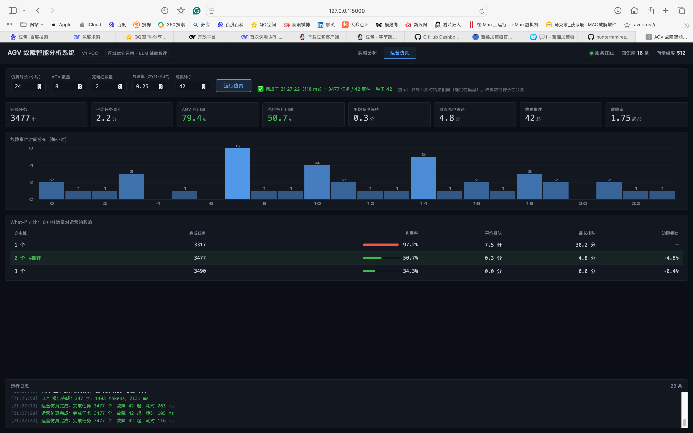

# AGV 故障智能分析系统

> 面向工业 AGV 现场事件的智能分析系统：**区域优先向量召回** + **规则安全决策** + **LLM 辅助解读** + **可量化的运营仿真**。
>
> 一个可完整运行的端到端 PoC——从现场事件文本出发，检索历史故障、给出安全结论、生成运维报告，并用仿真验证系统在真实负载下的表现。

---

## 核心成果

以下数字均可在本仓库中复现，**每条都标注了它是实测还是仿真估算**。

| 指标 | 结果 | 数据性质 |
|---|---|---|
| **区域优先召回的收益** | 跨区污染率 **17% → 0%**，代价是平均相似度 −0.0237 | 实测（A/B 对照） |
| **中文检索可用性** | 更换模型后，正确项与最佳错误项的分差 **+0.0002 → +0.2087** | 实测 |
| **LLM 响应速度** | 单次耗时 **10.6s → 2.0s**（5.4×），输出 token 减少 7.7× | 实测 |
| **LLM 可靠性** | 42 次真实调用 **42/42 成功**，降级时仍返回规则结论 | 实测 |
| **端到端成本** | LLM 延迟 P50 **2.17s** / P99 7.27s；年化 API 成本 **≈ ¥18** | 实测 + 外推 |
| **检索延迟** | P50 **19ms**，规则决策微秒级（不阻塞于 LLM） | 实测 |
| **运营吞吐能力** | 每天 **42 起**故障事件（1.75 起/小时），完成任务 3477 个/天 | 仿真估算 |
| **瓶颈识别** | 仿真定位充电桩为瓶颈：1→2 个吞吐 +4.8%，2→3 个仅 +0.4% | 仿真估算 |

**交付形态**：一个零依赖的 2D 控制台界面（实时分析 + 运营仿真两个页签）+ 命令行全链路测试 + 可复现的运营仿真报告 + 实验性 3D 联动。



*运营仿真页签：可调参数、8 项 KPI、故障事件时间分布、充电桩数量的 What-if 对比（自动标记拐点推荐）*

> 数据来源说明：**链路指标（延迟、token、成功率）是真实调用的实测值**；
> **运营指标（吞吐、利用率、排队）来自 SimPy 离散事件仿真模型**，
> 模型假设全部列在 [docs/SIMULATION.md](docs/SIMULATION.md) 中。

---

## 解决什么问题

工业现场 AGV 发生故障时，运维人员面临三个困难：

| 困难 | 现状 | 本项目的做法 | 响应时间 |
|---|---|---|---|
| 找不到历史案例 | 靠老师傅记忆或翻记录本 | 向量检索，语义匹配历史故障 | ~19 ms |
| 判断慢、标准不统一 | 依赖个人经验 | 规则系统给出风险等级与控制动作 | < 1 ms |
| 不知道从哪查起 | 排查凭感觉 | LLM 结合历史案例给出排查步骤 | ~2 s |

同时守住一条工业底线：**LLM 绝不参与安全决策**。

---

## 技术亮点

### 1. 区域优先召回：一个被数据验证、也被数据限定边界的设计

工厂天然按区域划分（装载/缓存/充电/避让），不同区域高频故障不同。全局检索的问题是**跨区共性故障互相污染**——"安全触边"在四个区域都有记录，全局检索会把其它区域的案例召回进来。

实现：指定区域时先在区域内检索，命中不足再全局补齐，最后按相似度重排。

**A/B 对照实测**（6 个跨区域共性故障）：

```
故障类型        A污染  B污染   A相似度  B相似度
过载报警类       67%    0%    0.6097  0.4943   ← 有代价
障碍物避让类      33%    0%    0.6003  0.5735
─────────────────────────────────────────────
平均            17%    0%    0.6553  0.6316
```

**结论不是"区域优先更好"，而是它解决特定问题：**
跨区污染降到 0，但平均相似度有 −0.0237 的代价；个别情况下（过载报警类）top1 相似度从 0.77 掉到 0.51，因为目标区域内没有语义最贴的记录。

所以正确用法是：**已知事件区域时用它降噪，不确定区域时用全局检索。**

### 2. 模型选型：一次由实测驱动的决策

最初使用 `all-MiniLM-L6-v2`（384 维英文模型），检索结果异常。打印分词后发现根因：

```
原模型：'视觉幻视' → ['[CLS]', '[UNK]', '[UNK]', '[UNK]', '[UNK]', '[SEP]']
       词表中文字符仅 488 个，且全部是 '##一' 这类接续子词，无法独立成词

BGE：  '视觉幻视' → ['[CLS]', '视', '觉', '幻', '视', '[SEP]']    UNK = 0
```

模型实际拿到的是一串未知符号，检索排序接近随机。换成 `bge-small-zh-v1.5`（512 维）后：

| 指标 | MiniLM | BGE |
|---|---|---|
| 中文分词 | 全部 `[UNK]` | 逐字切分，0 个 UNK |
| 正确项与最佳错误项分差 | **+0.0002** | **+0.2087** |
| 初始化耗时 | 1942 ms | 724 ms |

**这个问题的价值在于排查方法**：不是"换个更强的模型试试"，而是先验证模型是否认识这门语言。

### 3. LLM 安全边界：三层保障

| 层 | 机制 | 作用 |
|---|---|---|
| 提示词层 | 明确禁止修改风险等级、输出控制指令 | 软约束 |
| **代码层** | Harness 扫描违规措辞（`建议停机`、`可以恢复运行` 等 25 条） | **硬约束** |
| **架构层** | `rule_risk` / `rule_action` 全链路只读，无修改接口 | **不可绕过** |

实测中模型主动写出了这句话，证明约束生效：

> "风险等级'中风险'与控制动作'AGV减速运行，二次校验传感器数据'均为规则系统判定结果，此处仅原样引用"

**还修复了一个隐蔽缺陷**：`agv_agent` 内部捕获异常后会返回三段式兜底文案，该文案结构完整、无违规词，会被 Harness 误判为 `success`——把"LLM 失败"伪装成"分析成功"。现在通过 `last_fallback` 标记显式识别，压测统计才可信。

### 4. Agent Harness：把"能用"变成"可靠"

在 LLM 调用外加四层保障，上层业务零改动即可替换：

| 层 | 能力 | 说明 |
|---|---|---|
| 输出校验 | 违规措辞 + 三段结构 | 把软约束升级为可验证的硬约束 |
| 失败重试 | 指数退避 1s→2s→4s | 应对超时、网络抖动、空返回 |
| 降级兜底 | 永远返回可读报告 | 不中断 AGV 主链路 |
| 指标统计 | 耗时 / token / 成功率 / 降级原因 | 支撑成本核算与可用性监控 |

**输出预算也由 Harness 统一管控**，而不是写死在 agent 里：

```python
harness = AgentHarness(
    max_retries=2,
    max_output_tokens=600,    # API 层硬上限
    max_report_chars=800,     # 软阈值，超长只告警不重试
)
```

单次响应从 10.6 秒降到 2.0 秒，靠的是"提示词篇幅约束 + API 层硬上限"三层协同。

---

## 系统架构

```
              现场事件（感知模块 / 仿真 / 手工输入）
                              │
                              ▼
        ┌──────────────────────────────────────────┐
        │  vector_store.py   区域优先向量召回        │  ~19 ms
        │  └─ bge_embedding.py  中文向量化（ONNX）   │
        └──────────────────┬───────────────────────┘
                           ▼
        ┌──────────────────────────────────────────┐
        │  规则阈值决策（硬编码，微秒级）             │
        │  max_sim → 风险等级 + 控制动作            │
        └──────────────────┬───────────────────────┘
                           │  安全结论已确定，立即可用
                           ▼
        ┌──────────────────────────────────────────┐
        │  agent_harness.py  LLM 可靠性外壳          │  ~2 s
        │  └─ agv_agent.py   调用 DeepSeek          │
        │  输出校验 → 重试 → 降级 → 指标统计         │
        └──────────────────┬───────────────────────┘
                           ▼
        ┌──────────────────────────────────────────┐
        │  simple_logger.py  jsonl 全链路日志        │
        └──────────────────────────────────────────┘
```

**核心设计：快慢分离。** 检索与规则决策在 19ms 内完成，LLM 需要 2 秒。两者解耦，LLM 不可用或超时不阻塞安全决策。

| 模块 | 职责 | 不做什么 |
|---|---|---|
| `vector_store.py` | 知识库加载、区域优先召回 | 不打印日志、不调 LLM |
| `bge_embedding.py` | 中文向量化（离线 ONNX） | 不做检索 |
| `agv_agent.py` | 拼 prompt、调模型 | 不感知向量库与日志 |
| `agent_harness.py` | 校验 / 重试 / 降级 / 指标 / 预算 | 不做业务分析 |
| `simple_logger.py` | jsonl 落盘 | 不关心日志内容 |
| `test_vector_store.py` | 命令行业务入口 | — |

---

## 三个可运行的演示

### ① 2D 控制台界面（**主演示**）

```bash
./run.sh web        # → http://127.0.0.1:8000
```

界面分两个页签，对应两类岗位能力：

**页签一：实时分析**（AI 应用能力）

- 四区域俯视厂房，AGV 沿路径**连续巡游**，车头随行进方向转动
- 16 个预置故障事件；车开到哪个区域，就上报哪个区域的故障
- 检索结果与安全结论在 **十几毫秒** 内呈现，LLM 报告随后异步补齐
- 实时指标：召回耗时、LLM 耗时、token 用量、Harness 状态、安全校验结果

**页签二：运营仿真**（解决方案能力）

- 参数可调：仿真时长 / AGV 数量 / 充电桩数量 / 故障率 / 随机种子
- 8 项运营 KPI，带阈值着色（利用率 >85% 标红、>70% 标黄）
- 故障事件时间分布柱状图
- What-if 对比表：充电桩数量 → 吞吐 / 利用率 / 排队，并自动标记拐点推荐配置

技术栈：Python 标准库 `http.server` + 单文件 HTML/CSS/JS/SVG，**零 Web 框架、零前端构建**。

### ② 3D 联动（**实验性，不建议作为主演示**）

```bash
./run.sh scene      # 生成场景（3 台 AGV + 6 个障碍物）
./run.sh bridge     # 启动桥接器
```

AGV 自主导航（人工势场法避障）→ 到达区域 → 触发该区域故障分析 → 结果回写场景（区域高亮 + 车体变色 + 控制台日志）。

**实测数据**：0.44 m/s 移动，到站停留 4 秒，避障零穿模（189 次采样中最近距圆柱表面 +0.142 m）。

**为什么不建议作为主演示**：本机环境（macOS + CoppeliaSim 4.10 via ZMQ）存在若干不稳定因素，均已记录在下文"踩坑记录"中。核心问题是 **macOS App Nap 会让后台窗口的渲染挂起**——画面十几秒不刷新，看起来像"车不动"，而实际上数据一直在变。关闭 `NSAppSleepDisabled` 后好转，但仍需保证窗口不被完全遮挡。

> **结论**：3D 用于"证明这套链路能对接真实仿真软件"，但正式演示以 2D 界面为主。

#### 踩坑记录（对做工业仿真接入的人有参考价值）

1. **模型自带脚本会暂停仿真**：`dr12` 模型加载后，其 Lua 脚本向场景主脚本注入代码，仿真时间停在 0.15 秒、状态变为 8（paused）。逐个排查确认：禁用机器人脚本无效，**禁用场景主脚本才恢复**。最终改为自建图元车体，绕开全部脚本。

2. **REQ socket 不能设收发超时**：ZMQ 的 REQ 必须严格"发一次收一次"。一旦某次 `recv` 超时，未接收的回复会让 socket 进入非法状态，之后每次调用都报 `Operation cannot be accomplished in current state`，连接永久报废。曾因设了 15 秒超时导致首次分析后连接失效。

3. **物理驱动不可靠，改用运动学**：同样的 2 秒等待，仿真时间有时推进 0.0s、有时 1.7s，物理控制周期不可信。最终用 `setObjectPosition` / `setObjectOrientation` 直接设位姿，行为确定、可复现。

4. **启动前必须检查仿真状态**：在运行中的仿真上再调 `startSimulation()` 会让 Lua 线程死锁，此后所有 API 调用超时。

5. **相机需要显式复位**：场景程序化重建后，默认相机可能贴近地面，视野里只剩地板——物体存在但看不见。启动时用 look-at 矩阵重设相机。

6. **物体可见层要强制设置**：`createPrimitiveShape` 创建的对象需显式设 `visibility_layer = 1`，否则可能不渲染。

### ③ 终端：运营仿真与链路压测

```bash
./run.sh sim --no-llm     # 只跑运营模型（几十毫秒）
./run.sh sim              # 完整链路压测（含真实 LLM 调用，约 2 分钟）
./run.sh sim --what-if    # 充电桩数量对比
```

```
充电桩  完成任务  利用率   平均排队  最长排队
  1     3317    97.2%    7.5分   30.2分   ← 明确瓶颈
  2     3477    50.7%    0.3分    4.8分   ← 拐点
  3     3490    34.3%    0.0分    0.0分   ← 收益递减

边际收益：1→2 吞吐 +4.8%；2→3 仅 +0.4%
建议：2 个充电桩，继续扩容不值得
```

**两阶段设计**（指标来源严格分离）：

```
阶段一：SimPy 运营仿真              阶段二：真实链路压测
  8 台 AGV 任务流转、充电桩排队       42 起事件逐条送入
  按区域泊松过程注入故障              检索 → 决策 → LLM
        ↓                                  ↓
  【运营指标】模型估算              【分析指标】真实测量
```

这个设计本身验证了一个架构判断：**LLM 不在安全回路里，所以它的延迟不影响运营。**

---

## 快速开始

### 1. 安装依赖

```bash
pip install -r requirements.txt
```

纯 CPU 推理，无需 GPU。Web 服务仅用标准库，**不需要 flask/fastapi**。

### 2. 准备向量模型（离线）

本项目适配工业内网，**禁用联网下载**。需把 BGE ONNX 模型放到：

```
onnx_models/bge-small-zh-v1.5/onnx/
├── model.onnx              # 约 90 MB
├── tokenizer.json          # 约 0.42 MB
├── config.json
├── tokenizer_config.json
├── special_tokens_map.json
└── vocab.txt
```

### 3. 配置

```bash
cp .env.example .env
# 编辑 .env，填入 DEEPSEEK_API_KEY
```

### 4. 运行

```bash
./run.sh verify     # 全功能验证（24 项检查，交付/演示前跑这个）
./run.sh web        # 2D 控制台界面 → http://127.0.0.1:8000
./run.sh test       # 命令行全链路测试
./run.sh sim        # 运营仿真报告
./run.sh doctor     # 环境自检（出问题时定位用）
```

`verify` 会一次性验证 6 个层面：环境依赖、知识库与向量化、召回与决策、
LLM 链路、Web 接口（含临时起服务实测）、3D 联动（可选）。
必需项 24 项，全部通过才建议交付。

---

## 实测数据汇总

### 检索质量（3 组改写查询，非知识库原文）

| 用例 | 实测 top1 | 相似度 | 结果 |
|---|---|---|---|
| 装载区视觉幻视 | `fault_RAN_001` | 0.8314 | ✅ |
| 充电区电池高温 | `fault_RDA_001` | 0.7667 | ✅ |
| 避让区安全触边 | `fault_RAB_002` | 0.7106 | ✅ |

### 风险决策规则（硬编码，LLM 不可修改）

判据使用**最高相似度**而非平均相似度——后者会因 top_k 中的无关记录被拉低，导致"匹配最准反而判低风险"的反直觉结果。

```
max_sim < 0.45   → 高风险：AGV减速，重新扫描环境，上传异常日志
max_sim >= 0.78  → 高风险：AGV立即暂停，人工确认现场
max_sim >= 0.67  → 中风险：AGV减速运行，二次校验传感器数据
否则             → 低风险：AGV继续正常作业
```

### 运行指标

```
知识库          : 16 条（4 区域各 4 条）
向量维度        : 512
初始化耗时      : 460 ~ 724 ms
单次召回        : 19 ms (P50)
单次 LLM        : 2.17 s (P50) / 7.27 s (P99)
LLM 成功率      : 100% (42/42)
单次 token      : 约 1,477
年化成本        : ≈ ¥18
```

### 运营仿真（24 小时 / 8 台 AGV / 2 充电桩 / 种子 42）

```
完成任务数      : 3477 个
平均任务周期    : 2.2 分钟
AGV 利用率      : 79.4%
充电桩利用率    : 50.7%
平均充电等待    : 0.3 分钟
故障事件        : 42 起/天
```

---

## 项目结构

```
agv_embodied_project/
├── README.md
├── requirements.txt
├── .env.example               # 配置模板（.env 不入库）
├── .gitignore
├── knowledge_base.json        # 故障知识库（16 条，4 区域）
│
├── vector_store.py            # 区域优先召回
├── bge_embedding.py           # 中文向量化（离线 ONNX）
├── agv_agent.py               # LLM 调用与提示词
├── agent_harness.py           # LLM 可靠性外壳
├── simple_logger.py           # jsonl 日志
│
├── test_vector_store.py       # 命令行业务入口
├── web_demo.py                # 2D 控制台服务（实时分析 + 运营仿真两个页签）
├── templates/index.html       # 单文件 UI（内联 CSS/JS/SVG，无前端构建）
│
├── fleet_sim.py               # SimPy 车队运营仿真 + 链路压测
├── coppelia_bridge.py         # CoppeliaSim 3D 桥接（实验性）
├── prepare_scene.py           # 程序化生成 3D 演示场景
├── scenes/agv_demo.ttt        # 生成的 3D 场景文件
│
├── verify.py                  # 全功能验证（24 项检查）
├── doctor.py                  # 环境自检（8 类前置条件）
├── run.sh                     # 统一启动入口
│
├── docs/
│   ├── API.md                 # HTTP 接口契约（含 /api/simulate）
│   └── SIMULATION.md          # 仿真报告（模型假设 + 标定过程）
│
├── experiments/               # 技术探索（直连 onnxruntime 等）
└── archive/                   # 历史备份（gitignored）
```

---

## 技术栈

| 层 | 技术 | 说明 |
|---|---|---|
| 向量化 | `chromadb` 内置 ONNX + `onnxruntime` | 离线 CPU 推理 |
| 向量存储 | 内存向量 + 手写余弦相似度 | 万级以上需换 HNSW |
| LLM | DeepSeek（OpenAI 兼容 SDK） | 低温度 0.2，输出受 Harness 管控 |
| Web 服务 | Python 标准库 `http.server` | 零第三方依赖 |
| 前端 | 原生 HTML/CSS/JS + SVG | 单文件，无构建 |
| 仿真 | SimPy | 纯 Python 离散事件引擎，30 KB |
| 日志 | jsonl（按日期分文件） | — |

---

## 局限与改进方向

| 限制 | 现状 | 改进方向 |
|---|---|---|
| 知识库规模 | 16 条 | 扩充至百条级，补充分层标签 |
| 检索实现 | O(n) 线性扫描 | 引入 HNSW 索引 |
| LLM 分析 | 单轮生成 | 增加"生成→自检→修订"多轮 |
| 规则阈值 | 硬编码 | 外置为配置文件 |
| 运营参数 | 基于假设 | 部署后替换为真实运维数据 |
| 服务安全 | 仅监听本地，无鉴权 | 生产需加认证与限流 |
| 3D 联动稳定性 | macOS App Nap 会导致渲染挂起 | 演示前关闭 App Nap，保证窗口可见 |
| 2D 动画表现力 | SVG 手绘，无法做到 Plant Simulation 级别的工程仿真画面 | 定位为"数据面板"而非"仿真画面" |

---

## 文档索引

| 文档 | 内容 |
|---|---|
| [docs/API.md](docs/API.md) | HTTP 接口契约、请求响应格式、稳定性承诺 |
| [docs/SIMULATION.md](docs/SIMULATION.md) | 仿真模型假设、参数标定过程、what-if 分析、局限说明 |

---

## 项目定位说明

本项目是一个 **V1 PoC**，聚焦一个具体命题：**如何把 LLM 安全地接进工业现场链路**。

刻意不做的事情：

- ❌ 不做 VLA / 视觉-语言-动作模型（需云端算力与大量标注数据）
- ❌ 不做模型微调（通用模型 + 提示词约束已满足 PoC 需求）
- ❌ 不追求检索指标刷榜（更关注架构合理性与安全边界）

**如果只看一件事**：这个项目展示的是"把 AI 能力放进有安全约束的工业系统"的完整工程判断——包括选型依据、性能取舍、失败降级，以及对自己方案边界的诚实描述。

---

## 许可证

MIT License，详见 [LICENSE](LICENSE)。
